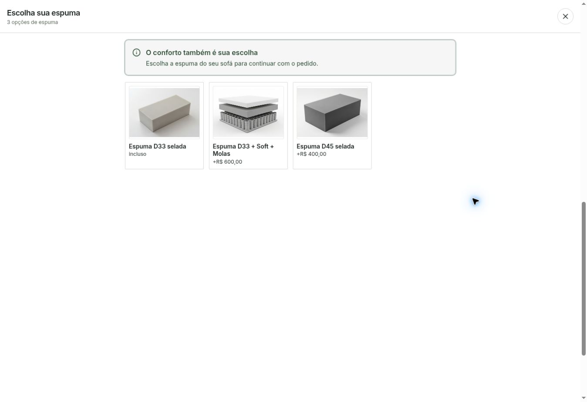

# Conferência ao vivo — 05/11/2026

Render dep-dbm9ldjbc2fs73avmr9g live, commit f87643b485ad312b291313e76de4c12ccbc849eb.

URL verificada: https://sofa-king-api-preview.onrender.com/produto/retratil-istambul?escolhas=f87643b

PASS: sem escolhas, Enviar meu pedido abre lista de álbuns com aviso de tecido. Escolher Elements > Ródio01 e tentar enviar abre seleção de espumas com aviso correto; modelo permanece na página, sem envio. Foto das espumas carregada e descrição legível no notebook. Confirmação após atualização dos arquivos do Preview; primeira requisição ainda tinha bundle antigo em cache.

Testes locais de carrinho e dois tamanhos de tela constam no relatório e results.json. Nenhum clique no envio final real, nenhuma mensagem/pedido criado. Produção não alterada.

