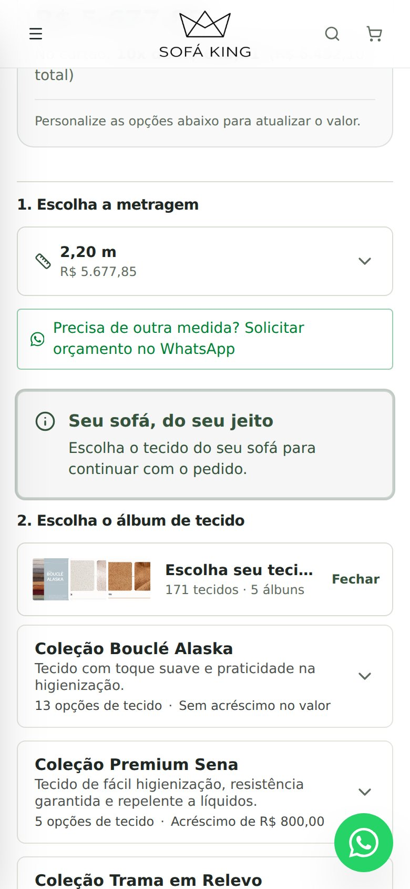
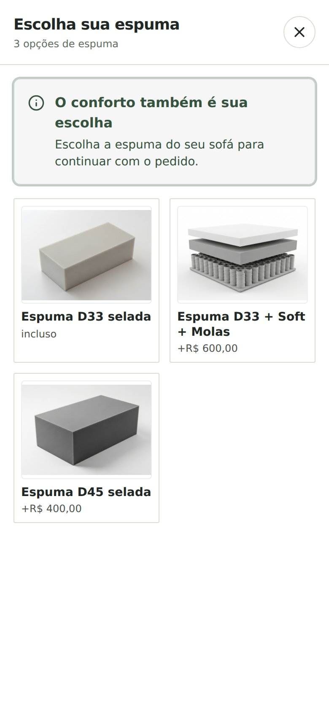

# Tecido e espuma obrigatórios — Preview — 05/11/2026

Base d5c2fdf46e8e033c2f109b6bb8925632934bff59. Implementação c7732a29cf8c44524e41c40a414a524aaf4eb192. Somente Preview; nenhuma mudança de banco, API, preços oficiais, produção ou main.

Os botões Adicionar ao carrinho e Enviar meu pedido exigem tecido e espuma explicitamente escolhidos, inclusive espuma inclusa. A regra se aplica quando o modelo tem opções disponíveis e associadas. Modelos sem opções não ficam bloqueados por uma escolha impossível.

Faltando ambas: abre a lista de álbuns e destaca “Escolha o tecido do seu sofá para continuar com o pedido.” Faltando espuma: abre a seleção de espumas e destaca “Escolha a espuma do seu sofá para continuar com o pedido.” Cartões com cores do site, foco e deslocamento para a área correspondente.

O envio final do carrinho também valida. Itens antigos incompletos consultam as associações do modelo. Falha na consulta bloqueia envio e permite tentar novamente. Se a consulta confirmar que não são exigidas as opções ausentes, pede um segundo toque para abrir o WhatsApp de forma síncrona. Completar um item restaura opções ainda disponíveis e substitui o mesmo item preservando quantidade/id, sem duplicar. Tecidos antigos sem id são identificados por nome e imagem.

## Validação
Build Vite, TypeScript, diff check e 9 testes Node passaram (7 regressões existentes e 2 de requisitos). Avisos preexistentes de sourcemap/bundle permanecem.

Playwright Chromium: 390x844 com toque/DPR2 e 1366x900; fixtures de leitura da API de testes e imagens reais do repositório. PASS: falta de ambas abre tecidos e aviso fica na tela; falta de espuma abre picker; fechar e reenviar continua bloqueado; nenhuma cotação ou item antes de completar; espuma inclusa exigida; configuração completa chega ao carrinho; URL WhatsApp contém espuma; item antigo sem espuma preserva tecido, metragem e quantidade2; id preservado/sem duplicação; falta de tecido preserva espuma. Sem erros de aplicação. Script externo Clerk bloqueado pelo harness excluído da contagem. Não é teste físico Safari/iPhone nem auditoria de login/admin.

window.open e eventos interceptados: nenhum pedido/mensagem real enviado. As verificações funcionais e a compilação foram repetidas após recuperação do ambiente local.

