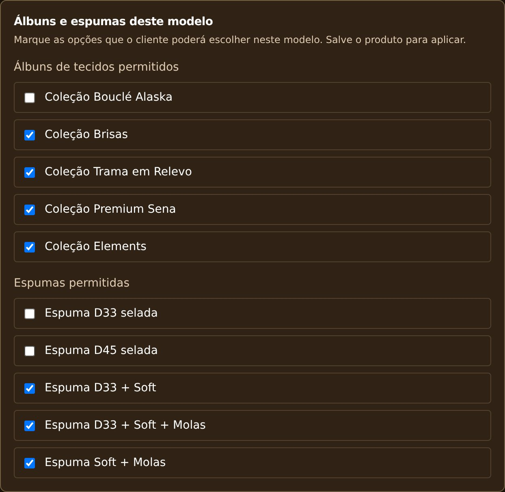
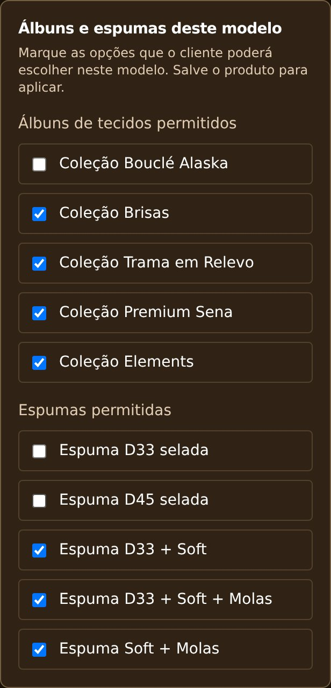

# Álbuns e espumas por modelo — produção — 05/11/2026

Autorizado pelo usuário publicar somente esta opção. Status READY no domínio oficial. Commit bcb2dd87342aaa74484dc92c8b9f296f4483eec3, branch release/model-material-options-20261105, deploy dpl_9wjgj68RYMUK7hdD3oCMjdRvSBTf, projeto prj_6mFptyDbClfYv1jVSbb0MD9X9pc3, time team_yUnM3GCF1znzXSnLjA7SpzXf.

## Escopo revisado
Base exata da produção anterior: 3f5ff096a51f976b422c5778f3ba2e7524a3b2fc.
Somente Admin.tsx (30 inclusões/1 remoção) e Produto.tsx (3 inclusões/3 remoções).
- Painel oferece somente seleção dos álbuns de tecidos e espumas permitidos por modelo, em bloco “Álbuns e espumas deste modelo”.
- Edição busca o produto atual antes de montar o formulário, evitando checkbox obsoleto de cache.
- Página do cliente filtra álbuns/espumas ativos pelas associações do modelo.
- Sem configuração definida mantém opções ativas; lista vazia não oferece opções desse tipo.
Não inclui seleção obrigatória do pedido, novos braços/pés/variações, tecidos individuais, alterações de prazos/preços, carrinho, login, galeria ou medidas. Nenhuma mudança de API/backend/banco. Sem merge na main e sem alterações na branch Preview.

## Validação
Build Vite, TypeScript e diff check passaram. Avisos preexistentes de sourcemap tooltip e bundle >500kB permanecem.
Playwright Chromium 390x900 com toque/DPR2 e 1366x900: remover exatamente duas espumas e um álbum; payload correto; salvar e reabrir; recarregar com lista deliberadamente obsoleta e detalhe atualizado; campos continuam desmarcados; configurações paralelas (medidas/prazo) e preços/metragens preservados; cliente omite as opções desmarcadas; listas vazias e padrões sem configuração preservados. PASS, sem erros de aplicação. Clerk e API simulados apenas no harness local; mock/config de QA não foram publicados.

Teste real adicional na API Preview conectada exclusivamente ao Supabase lcmtaxesbctibpyggbuj: criado modelo descartável Atlas Retrátil99, indisponível, descrição QA; escolhido um álbum e uma espuma, salvo via painel; recarregado e reaberto com marcações persistidas. Modelo descartável excluído depois, total voltou de106 para105 no ambiente de testes. Nenhum modelo oficial foi editado. O painel usado nesse teste real é o Preview existente; a composição exata do pacote de produção foi testada pelo harness.

## Pós-publicação
Domínio sofakingestofados.com.br aponta ao deploy READY e commit corretos. Arquivo servido /assets/index-DyDOVMsw.js contém os controles. O navegador de produção não tinha sessão autorizada do painel e exibiu Acesso restrito; não se alegou teste autenticado de salvamento na produção.
106 modelos oficiais: id/price/sizes/priceAdjustmentPercent/configuration iguais antes/depois. SHA256 normalizado44f976a3f58840d92de7153c9962c9b1d4d0fb0b9a93bf3acd5e88e5de383d83.
Sem envio de WhatsApp/pedidos. Título antigo Guia de Deploy preservado, fora do escopo.

## Rollback
Anterior dpl_6qk7sCoVq3FkCBDX3J1bwRVwP4PJ (3f5ff096a51f976b422c5778f3ba2e7524a3b2fc). Retorno pode ser feito pelo rollback Vercel no mesmo projeto/time, sem migração.

