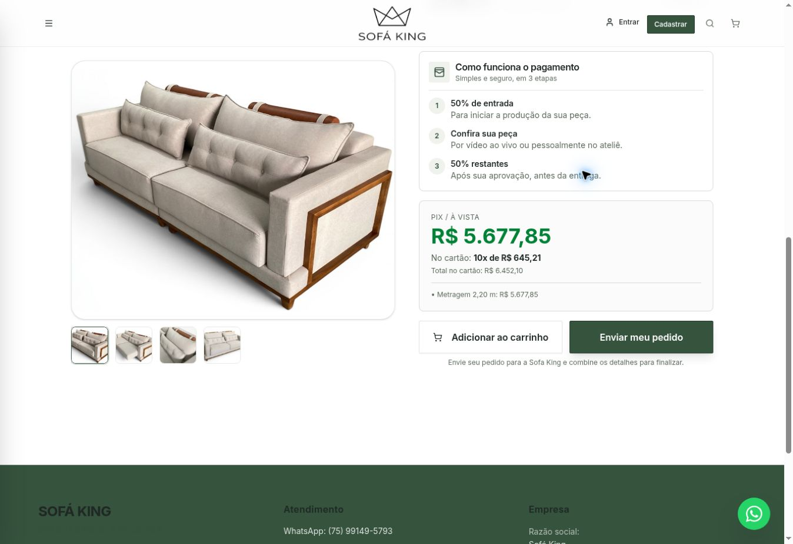
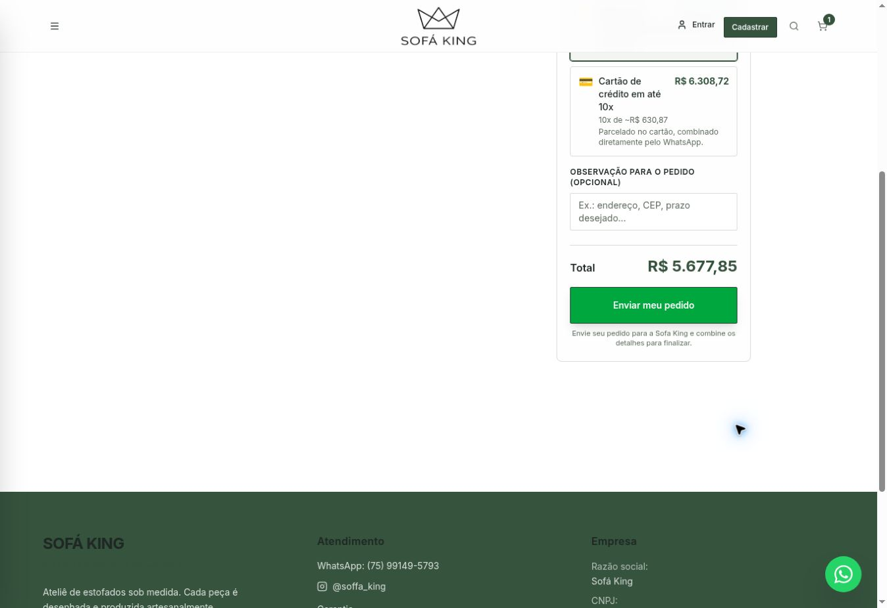

# Textos do pedido em produção — 05/11/2026

Status READY. Commit 3f5ff096a51f976b422c5778f3ba2e7524a3b2fc, branch release/order-text-20261105, deploy dpl_6qk7sCoVq3FkCBDX3J1bwRVwP4PJ. Domínio oficial confirmado: https://sofakingestofados.com.br/produto/retratil-istambul e /carrinho.

Base da produção: 99f7eff0bc579f4fc5d051f33a50dc2d618b5dbd, com zoom preservado. Somente quatro substituições literais (2 em Produto.tsx, 2 em Carrinho.tsx); funções, preços, API e layout sem alterações. Nenhum merge na main.

- Produto: Comprar agora -> Enviar meu pedido.
- Carrinho: Solicitar contato no WhatsApp -> Enviar meu pedido.
- Descrição em ambas: Envie seu pedido para a Sofa King e combine os detalhes para finalizar.

Build Vite, TypeScript e diff check passaram. Avisos preexistentes de bundle/sourcemap permanecem.
Validação ao vivo: os dois botões e as duas descrições foram observados no domínio oficial, depois do status READY. Capturas anexas. Preparado um item apenas no carrinho local para visualizar o botão; removido após a captura. Nenhum pedido enviado ao WhatsApp, nenhum cadastro ou banco alterado. Não foi uma auditoria global do site.

Rollback de referência: dpl_6n3CKAK1w7WJnnHVqs5bqHUKHH5E (versão anterior com zoom e textos antigos).

