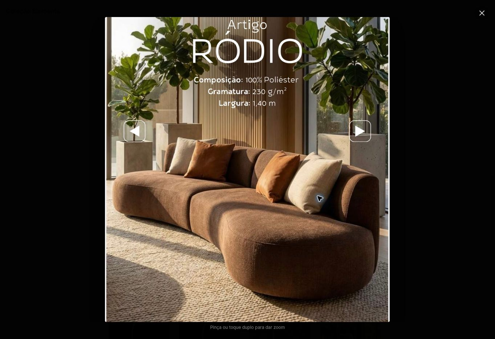

# Validação ao vivo do zoom — 05/11/2026

Preview: https://sofa-king-api-preview.onrender.com/produto/retratil-istambul?zoom=d5c2fdf

Render deploy dep-dbm8iip7lnhs738r5750, status live, commit d5c2fdf46e8e033c2f109b6bb8925632934bff59. Bundle observado na página: index-CN2Xl5yJ.js.

- PASS: abrir Elements > Artigo Ródio > Ampliar imagem; foto carregada e lightbox em z-index 140.
- PASS: Fechar retorna ao detalhe; próximo tecido e seleção explícita Ródio 01 funcionam.
- PASS: selecionar Espuma D45 selada soma R$ 400,00: R$ 5.677,85 -> R$ 6.077,85 no ambiente de testes.
- PASS: botão Enviar meu pedido do produto obtém cotação e leva ao carrinho, preservando metragem 2,20 m, álbum Elements, Ródio 01, D45 e R$ 6.077,85.
- PASS: carrinho mantém o texto Enviar meu pedido e a descrição aprovada. Nenhum clique no envio final ao WhatsApp.
- PASS: removido somente o item adicionado para este teste; item preexistente preservado.
- PASS: body overflow vazio após fechar janelas; carrinho cabe na largura do navegador (1348 <= 1363).

Os testes de pinça, arraste e toque duplo foram feitos em Chromium com entrada de toque e duas larguras de celular, conforme results.json na pasta. Não houve teste físico Safari/iPhone nem auditoria integral do administrativo. O log ao vivo consultado continha mensagens da extensão do navegador, não do aplicativo. Nenhuma alteração de produção, main, backend ou preços/dados oficiais.

